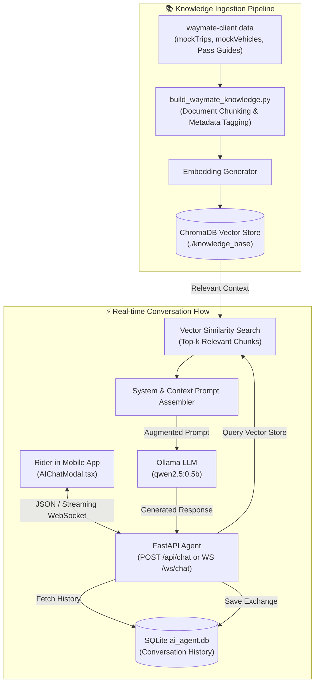

# 🧠 WayMate AI Agent (Intelligent Copilot & Knowledge Engine)

[](https://www.python.org/)
[](https://fastapi.tiangolo.com/)
[](https://ollama.ai/)
[](https://www.trychroma.com/)
[](https://www.langchain.com/)
[](LICENSE)

> Autonomous, privacy-first AI Copilot and Retrieval-Augmented Generation (RAG) knowledge engine for **WayMate - Adventure Passion Hub**. Powered by **Qwen 2.5 0.5B** via **Ollama**, ChromaDB vector store, and FastAPI to deliver instantaneous, bilingual adventure insights and motorcycle maintenance advice.

---

## 🧭 Table of Contents

- [🌟 Purpose & Core Capabilities](#-purpose--core-capabilities)
- [🏛️ RAG Architecture & Data Flow](#️-rag-architecture--data-flow)
- [🚀 Key Features](#-key-features)
- [📂 Project Directory Structure](#-project-directory-structure)
- [📊 API & WebSocket Interface](#-api--websocket-interface)
- [⚙️ Configuration & Environment Settings](#️-configuration--environment-settings)
- [🛠️ Installation & Setup Guide](#️-installation--setup-guide)
- [🔄 Knowledge Base Ingestion Pipeline](#-knowledge-base-ingestion-pipeline)
- [📱 Mobile UI Integration (waymate-client)](#-mobile-ui-integration-waymate-client)

---

## 🌟 Purpose & Core Capabilities

When traveling through remote mountain loops like **Hà Giang**, **Đà Lạt**, or **Đèo Hải Vân**, riders frequently encounter critical situations where internet access may be intermittent, and immediate expert advice is crucial:
- **Mechanical emergencies**: "My engine is overheating on the pass climb, what should I check?" or "How often should I clean and lube my motorcycle drive chain?"
- **Route hazards**: Understanding hair-pin turns, steep gradients, dense fog hours on passes like Mã Pí Lèng or Pass Prenn, and petrol station gaps.
- **Trip planning**: Estimating riding hours, optimal homestay locations, and local roadside repair customs.

**WayMate AI Agent** serves as a 24/7 dedicated adventure copilot:
- **Zero Cloud API Fees**: Runs locally via **Ollama (Llama 3.2 1B)** on your development machine or server.
- **RAG Knowledge Precision**: Augmented with verified WayMate route coordinates, hotel recommendations, and vehicle maintenance rules.
- **Bilingual Mastery**: Effortlessly understands and answers in both **English (ENG)** and **Vietnamese (VIE)**.

---

## 🏛️ RAG Architecture & Data Flow



---

## 🚀 Key Features

### 1. 🤖 Local LLM Inference with Ollama
- Employs Meta's state-of-the-art **Llama 3.2 1B** parameter lightweight model.
- Near-zero latency response times with minimal GPU / RAM memory footprint.
- Runs 100% locally on `http://localhost:11434`.

### 2. 📚 Vector Retrieval-Augmented Generation (ChromaDB)
- Automatically indexes:
  - **Trips & Routes**: Hà Giang Northern Loop, Sài Gòn - Đà Lạt Highway 20, Highway 1 Coastal Route.
  - **Waypoints & Elevation**: Passes, viewpoints, homestays, petrol stops.
  - **Garage Intervals**: Engine oil (3,000 km bikes / 5,000 km cars), chains (800 km), brakes (10,000 km).
  - **Emergency Roadside Protocols**: Actions during punctures, battery drain, chain snap, or engine stalls.

### 3. 🌐 Dual Communication Protocols
- **REST API (`POST /api/chat`)**: Request-response format for single-turn interactions and headless integrations.
- **Bidirectional WebSocket (`WS /ws/chat/{session_id}`)**: Real-time streaming conversation with typing indicators and persistent session IDs.

### 4. 🌏 Native Bilingual Support
- Recognizes user language automatically.
- Responds naturally in Vietnamese (Tiếng Việt) with culturally accurate motorbike terminology (*"thủng lốp"*, *"đứt xích"*, *"đổ đèo"*, *"bình ắc quy"*) and English.

---

## 📂 Project Directory Structure

```
waymate-agent/
├── build_waymate_knowledge.py       # Ingestion script to vectorize waymate-client data into ChromaDB
├── chat_manager.py                  # Session manager, conversation history, and context assembly
├── config.py                        # Pydantic settings (ports, URLs, timeouts, allowed CORS)
├── database.py                      # SQLite database connector for persistent chat logs
├── download_blobs.sh                # Helper script for offline model blob retrieval
├── init_model.py                    # Model validation and Ollama connectivity tester
├── main.py                          # FastAPI application, route handlers, and WebSocket endpoints
├── ollama_client.py                 # Async Ollama HTTP client with streaming & fallback logic
├── requirements.txt                 # Python dependencies
├── start.py                         # Startup runner with port checks and knowledge base sync
├── website_scraper.py               # Optional web scraper to pull dynamic route articles
├── ai_agent.db                      # SQLite database holding session dialogues
└── knowledge_base/                  # ChromaDB vector store directory containing embeddings
```

---

## 📊 API & WebSocket Interface

### REST Endpoints
| Method | Endpoint | Description |
| :--- | :--- | :--- |
| `POST` | `/api/chat` | Send a message to the AI Agent. Returns answer, sources, and session ID. |
| `GET` | `/api/health` | Health check verifying Ollama connection and loaded knowledge base. |
| `GET/POST`| `/api/learn-waymate` | Re-triggers knowledge base extraction from `waymate-client`. |
| `GET` | `/api/knowledge-base/stats` | Returns document count, categories, and vector embeddings count. |
| `GET` | `/api/sessions/{session_id}/history` | Retrieves conversation transcript for a given session. |

#### Example Request (`POST /api/chat`):
```json
{
  "message": "Bao lâu thì nên thay nhớt xe máy số và xe ga khi đi phượt Đà Lạt?",
  "session_id": "session-rider-123",
  "user_id": "user-456"
}
```

#### Example Response:
```json
{
  "response": "Khi đi tour đèo dốc như Đà Lạt, động cơ sinh nhiệt lớn. Theo tiêu chuẩn WayMate Garage:\n- Thay nhớt định kỳ mỗi 2,500 – 3,000 km đối với xe số/côn tay (nhớt 10W40/10W50).\n- Xe tay ga nên thay nhớt máy mỗi 2,000 – 2,500 km và nhớt lap (hộp số) sau mỗi 2-3 lần thay nhớt máy.\nNgoài ra, hãy kiểm tra phanh và xích trước khi đổ đèo Bảo Lộc hay Prenn nhé!",
  "session_id": "session-rider-123",
  "sources": ["waymate_maintenance_rules", "dalat_pass_guide"],
  "model": "llama3.2:1b"
}
```

### WebSocket Endpoint
- **URL**: `ws://localhost:8000/ws/chat/{session_id}`
- **Payload Format**:
  ```json
  {
    "message": "What is the best time to do the Ha Giang loop?",
    "user_id": "user-456"
  }
  ```

---

## ⚙️ Configuration & Environment Settings

Configured in [`config.py`](file:///d:/waymate/waymate-agent/config.py) or overridden via `.env`:

```env
# Server
PORT=8000
HOST=0.0.0.0

# Ollama LLM
OLLAMA_HOST=http://localhost:11434
OLLAMA_MODEL=qwen2.5:0.5b
OLLAMA_TIMEOUT=60

# Knowledge Base & Vector Store
KNOWLEDGE_BASE_PATH=./knowledge_base
DATABASE_PATH=./ai_agent.db
MAX_SEARCH_RESULTS=5

# Cross-Service Connections
WEBSITE_BASE_URL=http://localhost:8782
BACKEND_API_URL=http://localhost:8781
```

---

## 🛠️ Installation & Setup Guide

### Option A: Run via Docker (Recommended)

The Dockerfile is configured to **automatically install Ollama and download the `qwen2.5:0.5b` model during image build**, so the container is 100% self-contained:

```bash
# Stand at /waymate or /waymate/waymate-agent
docker build -t waymate-agent:latest .

# Run container on port 8000 and 11434
docker run -d \
  --name waymate-agent \
  -p 8000:8000 \
  -p 11434:11434 \
  waymate-agent:latest
```

---

### Option B: Local Setup

### 1. Prerequisites
- **Python 3.8+**
- **Ollama**: Download and install from [ollama.ai](https://ollama.ai)

### 2. Pull the Qwen 2.5 Model
```bash
# Start Ollama daemon
ollama serve

# In a separate terminal, pull the 0.5B ultra-lightweight model
ollama pull qwen2.5:0.5b
```

### 3. Setup Virtual Environment
```bash
cd waymate-agent

# Create Python virtual environment
python -m venv venv

# Activate virtual environment
# Windows:
.\venv\Scripts\activate
# Linux/macOS:
source venv/bin/activate

# Install dependencies
pip install -r requirements.txt
```

### 4. Build the Vector Knowledge Base
Ingest all trips, mountain passes, and maintenance rules into ChromaDB:
```bash
python build_waymate_knowledge.py
```

### 5. Launch the AI Agent
```bash
python start.py
```
The server will start on `http://localhost:8000`. Test the health check endpoint:
```bash
curl http://localhost:8000/api/health
```

---

## 🔄 Knowledge Base Ingestion Pipeline

The script [`build_waymate_knowledge.py`](file:///d:/waymate/waymate-agent/build_waymate_knowledge.py) parses:
1. Curated route data from `waymate-client/src/data/mockTrips.ts`.
2. Vehicle service limits from `waymate-client/src/data/mockVehicles.ts`.
3. Emergency SOS troubleshooting manuals.
4. Vietnamese mountain pass safety guides.

Run it anytime new routes or maintenance items are added to keep the AI Copilot current:
```bash
python build_waymate_knowledge.py
```

---

## 📱 Mobile UI Integration (waymate-client)

In the mobile app (`waymate-client`), riders interact with this AI Agent via:
- **Draggable Floating Action Button** (`DraggableFloatingActions.tsx`): Positioned seamlessly above the bottom navigation bar.
- **Interactive AI Chat Modal** (`AIChatModal.tsx`): Rich glassmorphic modal with streaming messages, suggestion chips, and clear conversation history.

---

## 📄 License

MIT License. Crafted with ❤️ to ensure every adventure traveler rides with confidence.